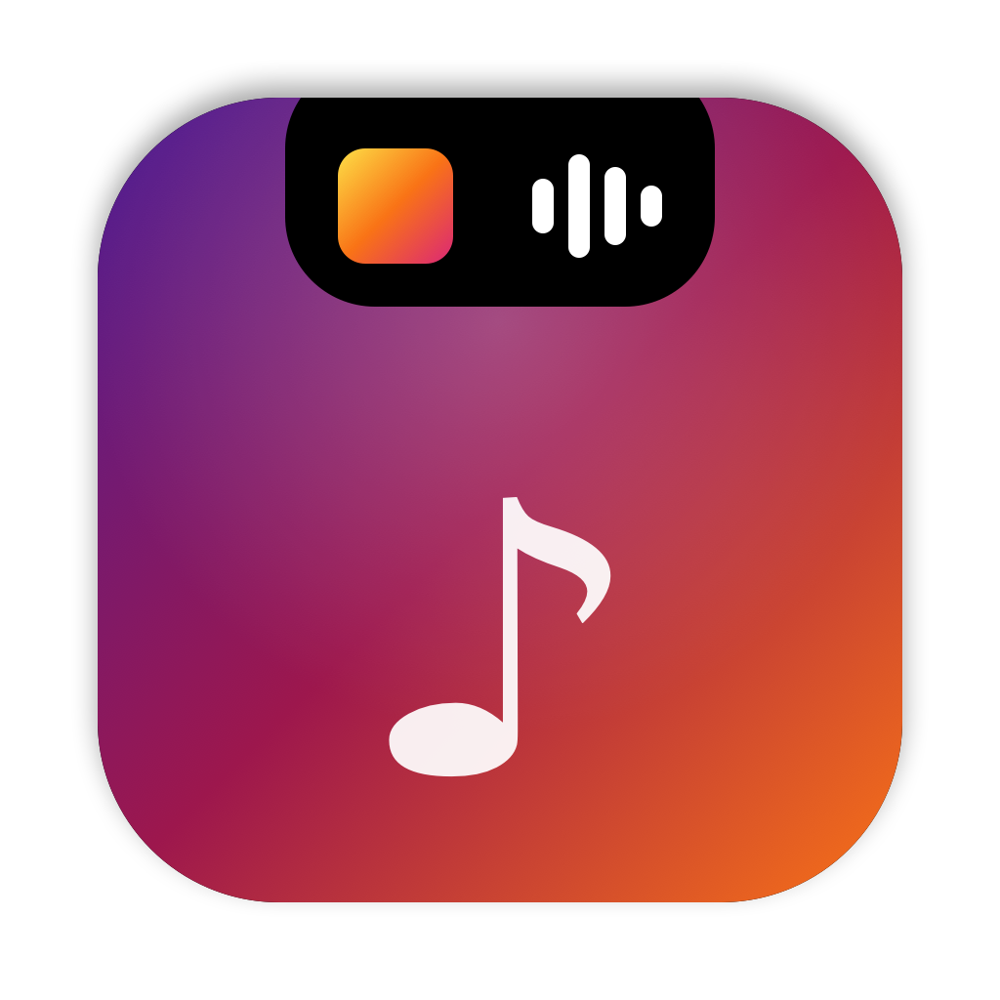
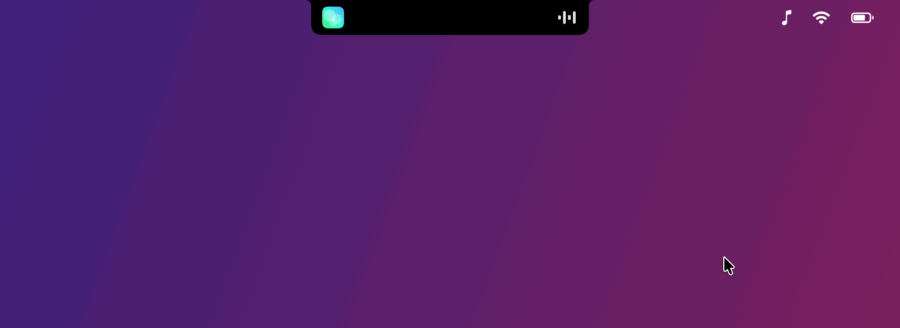
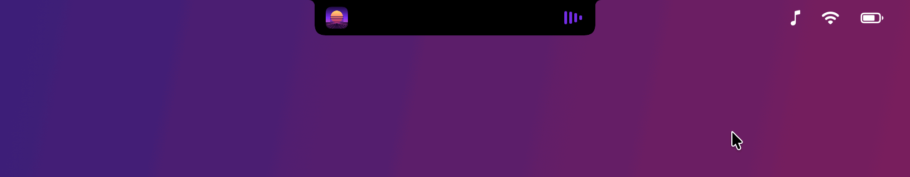
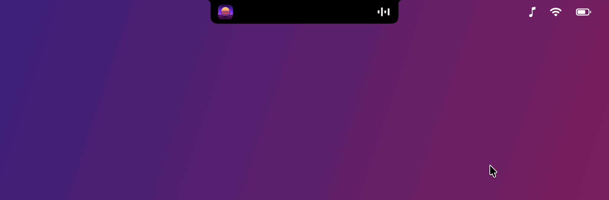
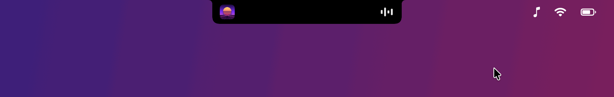
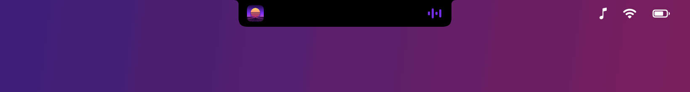
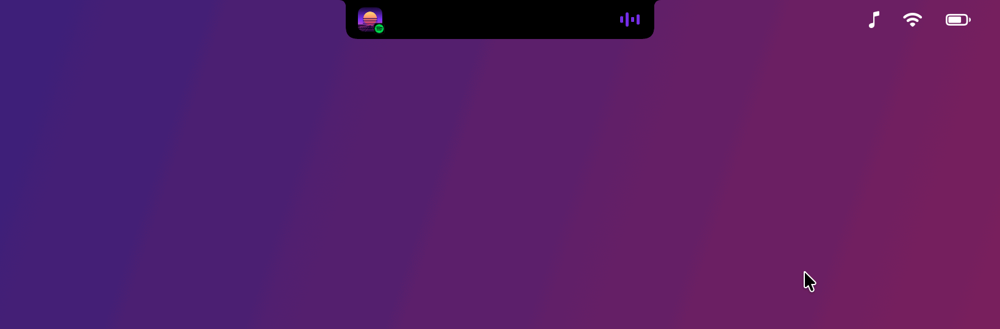
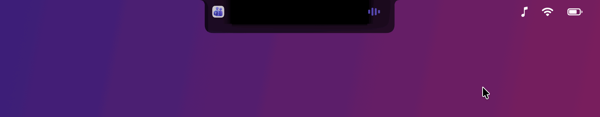
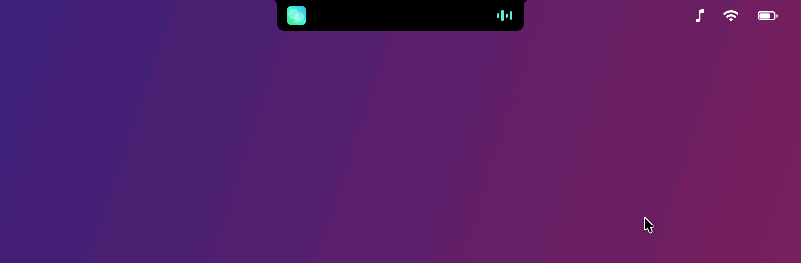
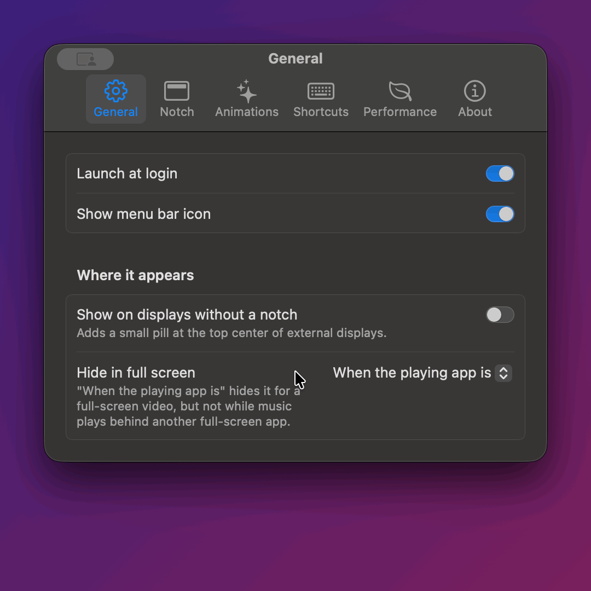

<p align="center">
  
</p>

<h1 align="center">MusicNotch</h1>

<p align="center">
  What's playing, right around your MacBook's notch.<br>
  Free, open source, and light on battery.
</p>

<p align="center">
  
</p>

<p align="center">
  <a href="https://github.com/doom1337hvh/MusicNotch/releases/latest"><b>Download</b></a> ·
  <a href="#install">Install</a> ·
  <a href="#in-action">In action</a> ·
  <a href="#settings">Settings</a>
</p>

MusicNotch shows whatever is playing on your Mac (Spotify, Apple Music, YouTube or SoundCloud in a browser, or any app that reports to macOS's Now Playing) around the notch. The album art sits to the left of the camera and equalizer bars to the right. Hover over the notch to open the controls. When nothing is playing, it disappears.

## Features

- **Three styles:** Minimal widens the notch with skip buttons. Compact opens a small panel. Full shows the artwork, title, a progress bar and all the controls.
- **Seek** by dragging the progress bar.
- **Colours:** the equalizer, progress bar and volume slider take on the album's colour, or a solid colour you pick.
- **Glass theme:** the open notch can be glass instead of black, with black fading out around the camera so it still grows out of the housing.
- **Shuffle, repeat this song, and volume** for Spotify and Apple Music.
- **Search:** find a song in your Music library and play it right from the notch, or send a search to Spotify, YouTube or SoundCloud.
- **Calls and games too:** apps that play sound or use the microphone without being music players, like a call or a game, show up with their icon and moving bars, and buttons to mute your microphone (for every app) and to deafen that app.
- **Several apps at once:** if Spotify is playing and a YouTube video is paused, the notch shows the one that's playing. The open panel has an icon for each app, so you can switch, and the controls reach apps in the background too.
- **New-track peek:** when the song changes, the notch briefly shows it.
- **Keyboard shortcuts** for opening the notch, play/pause and skipping, in any app.
- **Hides in full screen**, for example while you watch a video.
- **Stays out of your menu bar's way:** by default only the camera area opens the notch, so menu bar items beside it stay easy to click. It can also show nothing at all until you hover over it.
- **Built for battery life:** no polling and no Dock icon, and the app is under 2 MB. See [Battery](#battery).

Everything above can be switched off or changed in Settings.

## In action

Click one to watch it.

<details>
<summary><b>Compact</b> (the default): a small panel with the controls in one row, on glass.</summary>
<p align="center"></p>
</details>

<details>
<summary><b>Full</b>: every control. Drag the progress bar to skip through the song.</summary>
<p align="center"></p>
</details>

<details>
<summary><b>Minimal</b>: hover and the notch widens with skip buttons.</summary>
<p align="center"></p>
</details>

<details>
<summary><b>Closed</b>: the album art and equalizer sit on either side of the camera. When the music pauses, the bars become a pause icon.</summary>
<p align="center"></p>
</details>

<details>
<summary><b>Several apps</b>: each app with media gets an icon beside the camera; click one to switch. With lots of them, the strip of icons reaches out past the panel.</summary>
<p align="center"></p>
</details>

<details>
<summary><b>Calls and games</b>: an app in a call (using the microphone) or playing sound shows up too, with buttons to mute your microphone and to deafen it.</summary>
<p align="center"></p>
</details>

<details>
<summary><b>Search</b>: find a song in your Music library and play it without leaving the notch, or send a search to Spotify, YouTube or SoundCloud.</summary>
<p align="center"></p>
</details>

<details>
<summary><b>New track</b>: when the song changes, the notch briefly shows it.</summary>
<p align="center"></p>
</details>

## Requirements

- A Mac with Apple silicon, running macOS 14 Sonoma or later (developed and tested on macOS 27)
- A MacBook with a notch. Other Macs and external displays can show a small pill at the top of the screen instead; turn on **Show on displays without a notch** in Settings.

## Install

1. Download `MusicNotch-<version>.dmg` (or the `.zip`) from the [latest release](https://github.com/doom1337hvh/MusicNotch/releases/latest).
2. Drag **MusicNotch** into your **Applications** folder. Don't run it from Downloads: macOS runs apps opened there from a temporary copy, and MusicNotch can't work from that.
3. Open MusicNotch. macOS will say *"Apple could not verify 'MusicNotch' is free of malware"*. Click **Done**.
4. Open **System Settings → Privacy & Security**, scroll down to **Security**, and click **Open Anyway** next to *"MusicNotch was blocked"*. Confirm with **Open Anyway** and your password or Touch ID.
5. A ♪ appears in the menu bar. Play some music.

**Why the warning?** Apple only vouches for ("notarizes") apps whose developers pay for an Apple Developer account. MusicNotch is a free project and isn't notarized. The source code is all here, and you can [build it yourself](#build-from-source) instead.

**Prefer Terminal?** Instead of steps 3 and 4, run this, then open the app normally:

```bash
xattr -dr com.apple.quarantine /Applications/MusicNotch.app
```

**Check your download (optional):** each release lists SHA-256 checksums in `SHA256SUMS.txt`. Compare them with:

```bash
shasum -a 256 ~/Downloads/MusicNotch-*.dmg
```

## Updating

Quit MusicNotch (♪ → Quit), replace the app in Applications with the new one, and open it. Each new download needs **Open Anyway** once more. The permissions you've already given carry over, because every release is signed with the same certificate. If a release ever can't be, its notes will say so, and macOS will ask for them again.

## Permissions

MusicNotch works without any permissions. Each one below is only requested when you use the feature that needs it:

| Permission | Asked when | What it's for |
|---|---|---|
| **Automation** (Spotify, Music) | You first use the volume, shuffle or repeat button, or search Music | Reading and changing that app's own volume, shuffle and repeat, and searching your Music library, through AppleScript. Nothing else is sent to the app. |
| **System Audio Recording** | You first deafen an app | Silencing that app's sound. MusicNotch holds the app's sound back from the speakers with a Core Audio tap set to mute; it never reads from it, so nothing is recorded. |
| **Input Monitoring** | You turn on **Hide while swiping** | Noticing the moment a three-finger swipe between desktops begins. MusicNotch's listener only receives the Dock's swipe gesture: no keystrokes, no clicks, nothing else. |
| **Login Items** | You turn on **Launch at login** | Starting MusicNotch when you log in. |

Keyboard shortcuts use macOS's standard hotkey system and need no permission.

**Privacy:** MusicNotch never connects to the internet. It has no analytics, no accounts and no update checks. What's playing, your settings and everything else stay on your Mac.

## Settings

Open Settings from the ♪ menu bar icon, by right-clicking the notch, or by opening MusicNotch again while it's running (useful if you've hidden the menu bar icon).

<details>
<summary><b>See the Settings window</b></summary>
<p align="center"></p>
</details>

**General:** launch at login and the menu bar icon. Under *Where it appears*:
- **Show on displays without a notch:** adds a small pill to the top of external displays (off by default).
- **Hide in full screen:** *Never* (default), *When the playing app is*, which hides it while a full-screen app plays (a full-screen video, but also a full-screen browser playing anything), or *In any full-screen app*.

**Notch.** *When closed*:
- **Show artwork and bars beside the notch** (on by default): turn it off and nothing shows until you hover over the notch, so it looks like the plain camera housing.
- **Show new tracks** (on by default): briefly shows the new song when the track changes.
- **Show other apps playing sound** (on by default, macOS 14.2 or later): apps that play sound or use the microphone for more than a couple of seconds and aren't music players, like a call or a game, show with their icon and name. An app using the microphone is shown as in a call, and comes first, even over music; otherwise music comes first while it plays. Their panel has **Mute microphone**, which mutes your Mac's microphone for every app (the call app's own mute button doesn't change, and MusicNotch unmutes it when the call ends), **Deafen**, which silences just that app (and, for a call, mutes your microphone too, as call apps do; undeafening puts it back), and **Show app**. While one is shown, the play/pause and skip shortcuts still reach your music.

*Opening*:
- **Style:** Minimal, Compact (default) or Full.
- **Open on:** Hover (default) or Click.
- **Only open from the camera** (on by default): the closed notch's sides let clicks through to the menu bar, and only the camera area opens it.

**Appearance.** *Look*:
- **Theme:** Glass (default), which lets the desktop show through the open notch, with black fading out around the camera, or Black.
- **Colour** of the equalizer, progress bar and volume slider: *From the artwork* (default; the album's most vivid colour, or white for black-and-white artwork), *White*, or *Solid colour*, which you pick.

*In the open notch*: album artwork, the progress bar (drag it to seek), shuffle and repeat-this-song buttons (for Spotify and Music; Spotify doesn't let other apps use its own repeat-one, so for Spotify MusicNotch repeats the song itself, moving it back to the start just before it ends), the search button, and whether clicking the artwork opens the playing app.

**Search** (the 🔍 in the Compact and Full panels) depends on the app. Music shows matching songs from your library right in the notch: click one, or press Return for the top result. Spotify, YouTube and SoundCloud don't let other apps see their results, so pressing Return opens their own search with what you typed. A browser tab searches YouTube. Esc closes the search.

**Animations**
- **Open animation:** Bouncy (default), Pop, Blur or Instant.
- **Appear on the new desktop:** Fade (default), Slide, Zoom, Bounce, Blur or None.
- **Hide while swiping** (off by default): hides the notch as soon as a three-finger swipe begins, instead of letting it slide away with the old desktop. Needs Input Monitoring.

**Shortcuts:** open or close the notch, play/pause, next track, previous track. None are set by default. Click a field, then press the keys; Delete clears it. A notch opened from the keyboard stays open while the pointer is over it, and otherwise closes after a few seconds.

**Performance**
- **Low-resource mode:** one switch that turns off animations, glass, artwork and the progress bar, and batches updates once a second.
- **Turn on with Low Power Mode** (on by default): low-resource mode switches on by itself while macOS's Low Power Mode is on, and off again after.
- **Equalizer animation:** Always, Only when plugged in (default) or Never.
- **Update batching:** Instant, Balanced (default) or Battery saver.

**About:** the version, whether the media adapter is working, and the licences.

## Battery

Measured on an M5 MacBook Pro on battery while Spotify played, with the notch closed:

| | MusicNotch | Media adapter | CPU | Energy impact |
|---|---|---|---|---|
| Default settings | 15–19 MB | 6.5–7.8 MB | 0.0% | 0.0 |
| Low-resource mode | 15 MB | 6.5 MB | 0.0% | 0.0 |

The only ongoing cost is the animated equalizer. Its bars are drawn by macOS's WindowServer, which spends about 6% of one CPU core on them while music plays. That's why, by default, they only animate while your Mac is plugged in, and stay still on battery or in Low Power Mode.

The rest costs nothing while idle:
- There are no timers or polling; changes arrive as events.
- The progress bar only ticks, once a second, while the panel is open.
- Artwork is shrunk to 128 px when it arrives.
- When nothing is playing, the notch window is taken off the screen.

## Troubleshooting

- **Nothing appears:** play something, then check **Settings → About → Media adapter**. If it says the adapter keeps exiting, your macOS version may have changed something MusicNotch relies on (see below). Make sure the app is in Applications, not Downloads.
- **The buttons are dimmed for a browser tab:** your version of macOS doesn't let MusicNotch send commands to apps other than the current "Now Playing" one. Play/pause that tab once from the browser.
- **Volume, shuffle or repeat don't respond:** allow MusicNotch under **System Settings → Privacy & Security → Automation**.
- **The notch no longer hides while you swipe between desktops:** macOS has stopped allowing Input Monitoring, which can happen after an update. MusicNotch warns about this when it starts, and in its ♪ menu. In **System Settings → Privacy & Security → Input Monitoring**, remove MusicNotch if it's listed, add it again with **+**, and turn it on; it starts working without a restart.
- **A keyboard shortcut shows a warning sign:** another app already uses that shortcut. Pick another one.

## Unofficial APIs

Since macOS 15.4, Apple only lets its own apps read "Now Playing" information. MusicNotch reads it anyway: it uses [mediaremote-adapter](https://github.com/ungive/mediaremote-adapter), which runs inside `/usr/bin/perl`, a program Apple signs. To animate cleanly when you switch desktops, it also reads the desktop layout from SkyLight, a private macOS framework.

None of this is supported by Apple. A macOS update could break MusicNotch at any time, and there may be no fix. MusicNotch is an independent project, not affiliated with or endorsed by Apple, Spotify or anyone else.

## Uninstall

Quit MusicNotch (♪ → Quit), delete it from Applications, and optionally remove its settings:

```bash
defaults delete io.github.doom1337hvh.MusicNotch
```

You can also remove it from the lists in **System Settings → Privacy & Security**.

## Build from source

You need the Xcode Command Line Tools (`xcode-select --install`); neither Xcode nor cmake is needed.

```bash
git clone https://github.com/doom1337hvh/MusicNotch.git
```

```bash
cd MusicNotch && scripts/build.sh
```

The app is built to `build/MusicNotch.app`. `scripts/build.sh --install` also copies it to `~/Applications` and opens it there.

Optionally, run `scripts/create-signing-cert.sh` once first. It makes a local code-signing certificate, so the permissions you grant survive rebuilds; otherwise each build is signed ad hoc and macOS treats it as a new app. To make a release, see [docs/RELEASING.md](docs/RELEASING.md).

The clips above are recorded from the real app, acting out scripted scenes with made-up tracks. After a build, `swift scripts/make-video.swift` records them all again into `docs/demo.gif` and `docs/clips` (plus `docs/demo.mp4` for sharing); name scenes to record just those. It needs the Screen Recording permission and a MacBook with a notch.

### How it works

`scripts/build.sh` compiles mediaremote-adapter (pinned to v0.7.7) together with MusicNotch's own additions in `Adapter/`, into a small framework that `/usr/bin/perl` loads:
- `MusicNotchSessions.m` streams every app's media session, not only the one macOS treats as "now playing".
- `MusicNotchSend.m` sends a command to a specific app. macOS delivers media commands only to its current "now playing" app, so it briefly overrides that choice, sends the command, and puts it back, all in under half a second. The override is cleared on every way out, and a marker file lets MusicNotch clear one left behind by a crash.

The app itself is SwiftUI in an AppKit shell:

```
Sources/MusicNotch/
  AppDelegate.swift, main.swift   app lifecycle, menu bar icon
  DemoScene.swift                 made-up tracks and scripted scenes for the README's clips
  Media/                          adapter process, sessions parser, now-playing model,
                                  AppleScript (volume, shuffle, repeat)
  Notch/                          panels, geometry, views, animations, desktop switching
  Settings/                       preferences, keyboard shortcuts, the Settings window
Adapter/                          MusicNotch's additions to mediaremote-adapter
scripts/                          build, release, signing certificate, icon, README clips
```

## License

MusicNotch is released under the [MIT License](LICENSE). It includes mediaremote-adapter by Jonas van den Berg, under the BSD 3-Clause License; see [THIRD_PARTY_NOTICES.md](THIRD_PARTY_NOTICES.md).
